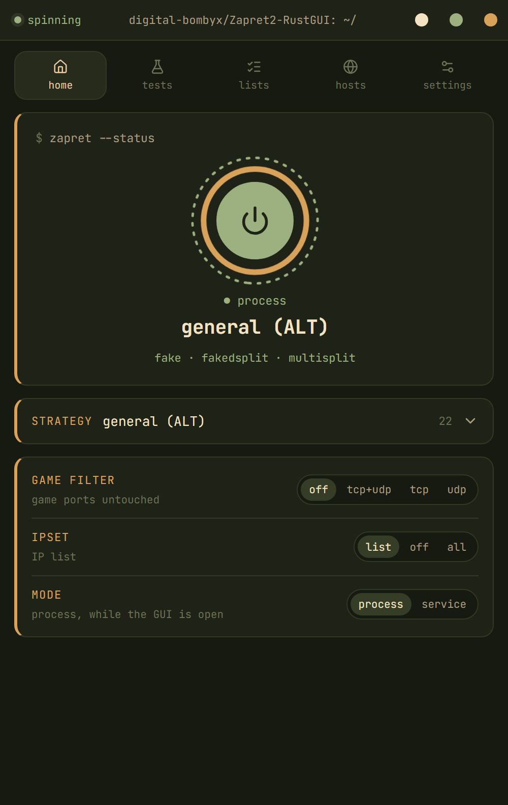
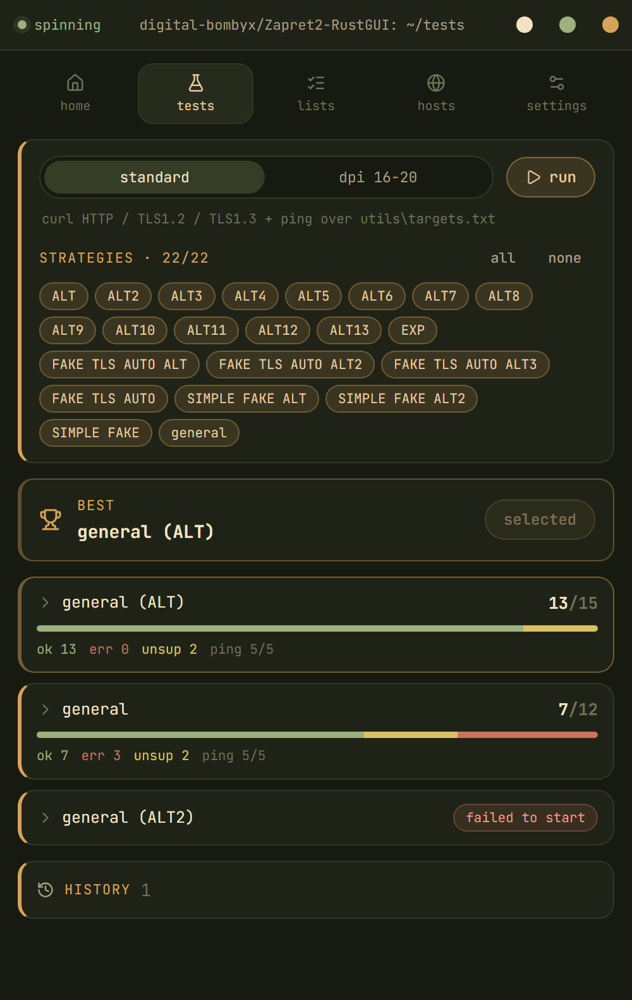
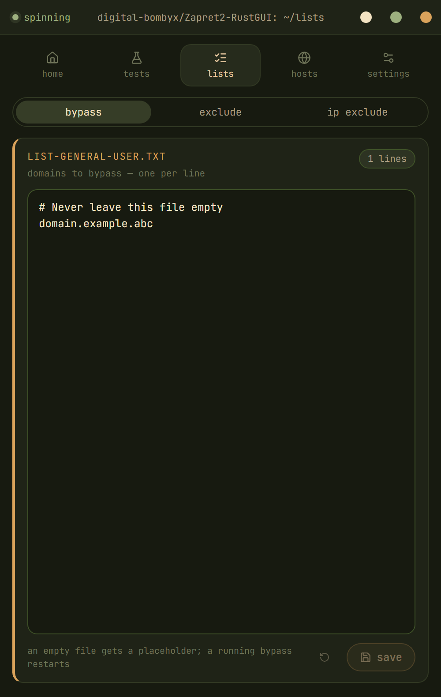
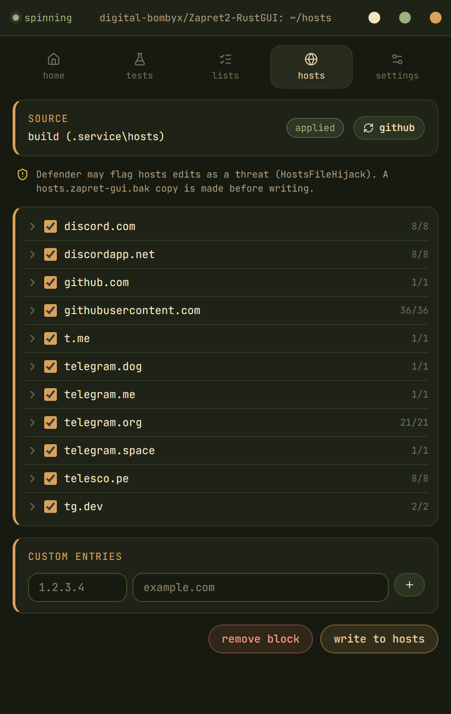
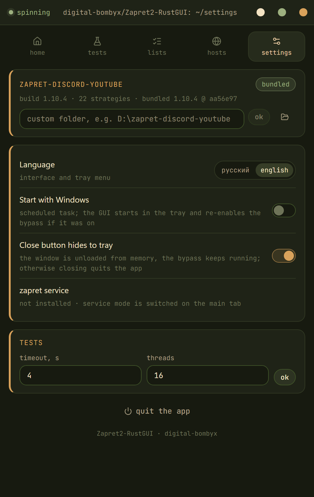

<div align="center">


# Zapret2-RustGUI

**A light, cozy GUI for [zapret-discord-youtube](https://github.com/Flowseal/zapret-discord-youtube) on the zapret2 engine (winws2 + Lua)**

One installer, no console windows: one-click toggle, strategy picking and testing, tray.

[Русский](README.md) · **English**


</div>

## Screenshots

<table>
  <tr>
    <td align="center" valign="middle" rowspan="2"><br /><sub><b>Home</b> — toggle, strategy, Game Filter, IPSet, mode</sub></td>
    <td align="center" valign="top"><br /><sub><b>Tests</b> — compare strategies</sub></td>
    <td align="center" valign="top"><br /><sub><b>Lists</b> — your own domains</sub></td>
  </tr>
  <tr>
    <td align="center" valign="top"><br /><sub><b>Hosts</b> — a separate hosts block</sub></td>
    <td align="center" valign="top"><br /><sub><b>Settings</b> — build, tray, language</sub></td>
  </tr>
</table>


## Features

- **Bundled zapret-discord-youtube.** The build ships inside the installer, so there is nothing to install separately. Updating the GUI updates the build too, and your lists and settings are kept. You can also point the app at a folder of your own.
- **One-click toggle.** `winws2.exe` is started directly, with no console. Run it as a process (while the GUI is open) or as the `zapret` service, which works without the GUI and is compatible with `service.bat`.
- **Strategies as they are.** Arguments are read straight from `general*.bat`, so new upstream strategies work right away. The home tab shows the bypass techniques of the selected strategy (`fake · multisplit · …`).
- **Strategy testing**, modeled on `utils\test zapret.ps1`:
  - standard test: HTTP / TLS 1.2 / TLS 1.3 + ping;
  - "16-20 KB" DPI test;
  - live progress, the best strategy highlighted with an "apply" button, and run history.
- **Game Filter and IPSet** switch in one click and write the same files as `service.bat`.
- **List editor** for `list-general-user`, `list-exclude-user` and `ipset-exclude-user`, with domain and IP validation.
- **Hosts.** Entries from `.service\hosts` are added to the system hosts file as a separate block that one button removes. Custom entries and updating from GitHub are supported, and a backup is made before writing.
- **Tray and autostart.** The tray gives a quick toggle and strategy switch. Autostart uses the Task Scheduler with administrator rights.
- **Russian and English** UI, including the tray menu.

## Install

1. Download `Zapret2-RustGUI_x.y.z_x64-setup.exe` from [Releases](https://github.com/digital-bombyx/Zapret2-RustGUI/releases/latest) and install it. A `.sha256` file is attached for verification.
2. Launch it. The app asks for administrator rights: WinDivert, services and hosts need them.
3. Press the big button. If sites still don't open, pick another strategy or run a test on the Tests tab.

> [!NOTE]
> The app ships `winws2.exe` and the WinDivert driver. Some antivirus products flag files like these. You can verify the files against the checksums of the [zapret2 release](https://github.com/bol-van/zapret2/releases).

## Building from source

You need Node.js, Rust (MSVC) and a git clone of [zapret-discord-youtube](https://github.com/Flowseal/zapret-discord-youtube):

```powershell
npm install
$env:ZAPRET_SRC = "D:\zapret-discord-youtube"   # this path is the default
npm run tauri build
```

Before building, `scripts/sync-zapret.mjs` takes a clean copy of the build from git (`git archive HEAD`) and puts it into the installer's resources. The installer ends up in `src-tauri\target\release\bundle\nsis\`.

Releases are built by GitHub Actions ([`release.yml`](.github/workflows/release.yml)) when a `vX.Y.Z` tag is pushed. The bundled zapret build is pinned to a commit there, and that file tree is verified on every release.

## Acknowledgements

- **[bol-van](https://github.com/bol-van)**, author of [zapret](https://github.com/bol-van/zapret) and [zapret2](https://github.com/bol-van/zapret2). The `winws` / `winws2` engine and the Lua libraries are his work ([zapret-win-bundle](https://github.com/bol-van/zapret-win-bundle)).
- **[Flowseal](https://github.com/Flowseal)** and the contributors of [zapret-discord-youtube](https://github.com/Flowseal/zapret-discord-youtube), for the build, strategies, lists and scripts this app is built on.
- The authors of [PR #18202](https://github.com/Flowseal/zapret-discord-youtube/pull/18202), which moved the build to zapret2. The bundled version is built with this PR; the branch's last commit is [`8511a71`](https://github.com/Flowseal/zapret-discord-youtube/pull/18202/commits/8511a718126d93c9fd1ff6bec3a560a7cb4e6867).
- **[basil00/WinDivert](https://github.com/basil00/WinDivert)**, the packet capture driver.
- **[hyperion-cs/dpi-checkers](https://github.com/hyperion-cs/dpi-checkers)**, the target suite for the "16-20 KB" DPI test.

All binaries and Lua scripts of the bundled build are distributed under their authors' licenses (see `LICENSE.txt` in the build folder).

<div align="center"><sub>Made with 🌿 by <a href="https://github.com/digital-bombyx">digital-bombyx</a></sub></div>
