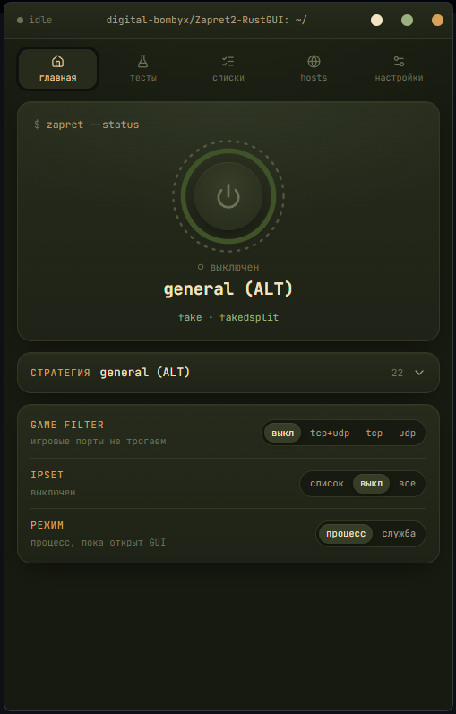
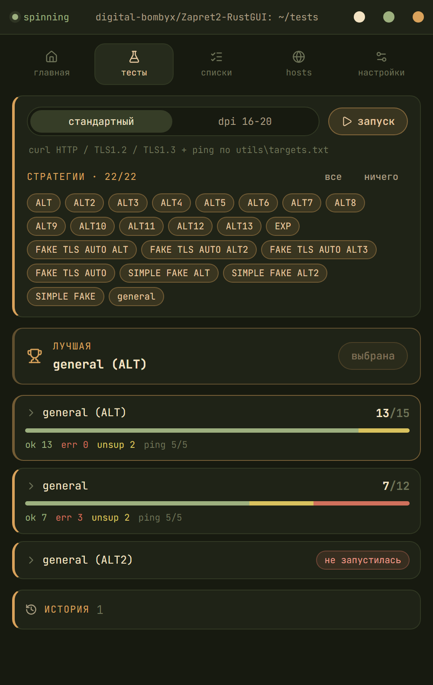
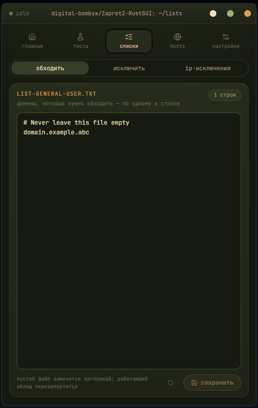
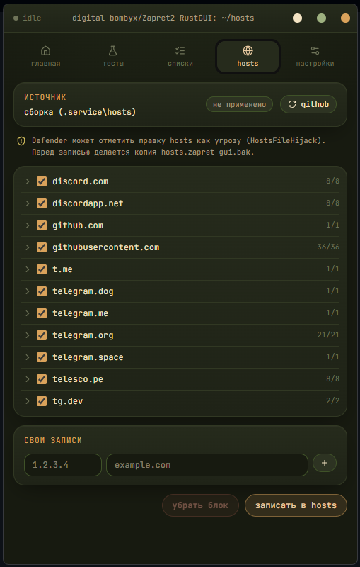
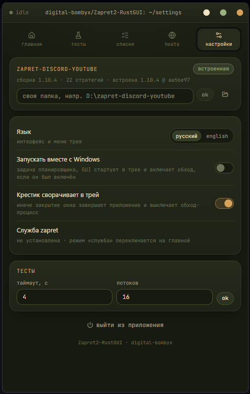

<div align="center">


# Zapret2-RustGUI

**Лёгкий и уютный GUI для [zapret-discord-youtube](https://github.com/Flowseal/zapret-discord-youtube) на движке zapret2 (winws2 + Lua)**

Один установщик, никаких консольных окон: включение в один клик, выбор и тестирование стратегий, трей.

**Русский** · [English](README.en.md)


</div>

## Скриншоты

<table>
  <tr>
    <td align="center" valign="middle" rowspan="2"><br /><sub><b>Главная</b> — тумблер, стратегия, Game Filter, IPSet, режим</sub></td>
    <td align="center" valign="top"><br /><sub><b>Тесты</b> — сравнение стратегий</sub></td>
    <td align="center" valign="top"><br /><sub><b>Списки</b> — свои домены</sub></td>
  </tr>
  <tr>
    <td align="center" valign="top"><br /><sub><b>Hosts</b> — отдельный блок в hosts</sub></td>
    <td align="center" valign="top"><br /><sub><b>Настройки</b> — сборка, трей, язык</sub></td>
  </tr>
</table>

## Возможности

- **Встроенный zapret-discord-youtube.** Сборка уже лежит внутри установщика, ставить её отдельно не нужно. При обновлении GUI обновляется и сборка, а ваши списки и настройки остаются. Можно указать и свою папку.
- **Включение в один клик.** `winws2.exe` запускается напрямую, без консоли. Можно включать как процесс (пока открыт GUI) или как службу `zapret`, которая работает без GUI и совместима с `service.bat`.
- **Стратегии без переделок.** Аргументы берутся прямо из `general*.bat`, поэтому новые стратегии из апстрима работают сразу. На главной видны техники обхода выбранной стратегии (`fake · multisplit · …`).
- **Тестирование стратегий** по образцу `utils\test zapret.ps1`:
  - стандартный тест: HTTP / TLS 1.2 / TLS 1.3 + ping;
  - DPI-тест «16-20 КБ»;
  - живой прогресс, подсветка лучшей стратегии с кнопкой «применить» и история прогонов.
- **Game Filter и IPSet** переключаются в один клик и пишут те же файлы, что `service.bat`.
- **Редактор списков**: `list-general-user`, `list-exclude-user`, `ipset-exclude-user`, с проверкой доменов и IP.
- **Hosts.** Записи из `.service\hosts` добавляются в системный hosts отдельным блоком, который снимается одной кнопкой. Есть свои записи и обновление с GitHub, перед записью делается бэкап.
- **Трей и автозапуск.** В трее быстрое включение и смена стратегии. Автозапуск работает через планировщик с правами администратора.
- **Русский и английский** интерфейс, включая меню трея.

## Установка

1. Скачайте `Zapret2-RustGUI_x.y.z_x64-setup.exe` и установите.
2. Запустите. Приложение попросит права администратора: они нужны WinDivert, службам и hosts.
3. Нажмите на большую кнопку. Если сайты не открываются, выберите другую стратегию или запустите тест на вкладке «Тесты».

> [!NOTE]
> Внутри лежат `winws2.exe` и драйвер WinDivert. Некоторые антивирусы помечают такие файлы как угрозу. Проверить файлы можно по контрольным суммам релиза [zapret2](https://github.com/bol-van/zapret2/releases).

## Сборка из исходников

Нужны Node.js, Rust (MSVC) и git-клон [zapret-discord-youtube](https://github.com/Flowseal/zapret-discord-youtube):

```powershell
npm install
$env:ZAPRET_SRC = "D:\zapret-discord-youtube"   # по умолчанию именно этот путь
npm run tauri build
```

Перед сборкой `scripts/sync-zapret.mjs` берёт чистую копию сборки из git (`git archive HEAD`) и кладёт её в ресурсы установщика. Готовый установщик появится в `src-tauri\target\release\bundle\nsis\`.

## Благодарности

- **[bol-van](https://github.com/bol-van)** — автор [zapret](https://github.com/bol-van/zapret) и [zapret2](https://github.com/bol-van/zapret2). Движок `winws` / `winws2` и Lua-библиотеки — его работа ([zapret-win-bundle](https://github.com/bol-van/zapret-win-bundle)).
- **[Flowseal](https://github.com/Flowseal)** и контрибьюторы [zapret-discord-youtube](https://github.com/Flowseal/zapret-discord-youtube) — сборка, стратегии, списки и скрипты, на которых держится это приложение.
- Авторы [PR #18202](https://github.com/Flowseal/zapret-discord-youtube/pull/18202) — перевод сборки на zapret2. Встроенная версия собрана с этим PR, последний коммит ветки — [`8511a71`](https://github.com/Flowseal/zapret-discord-youtube/pull/18202/commits/8511a718126d93c9fd1ff6bec3a560a7cb4e6867).
- **[basil00/WinDivert](https://github.com/basil00/WinDivert)** — драйвер перехвата пакетов.
- **[hyperion-cs/dpi-checkers](https://github.com/hyperion-cs/dpi-checkers)** — набор целей для DPI-теста «16-20 КБ».

Все бинарники и Lua-скрипты встроенной сборки распространяются под лицензиями их авторов (см. `LICENSE.txt` в папке сборки).

<div align="center"><sub>Сделано с 🌿 <a href="https://github.com/digital-bombyx">digital-bombyx</a></sub></div>
